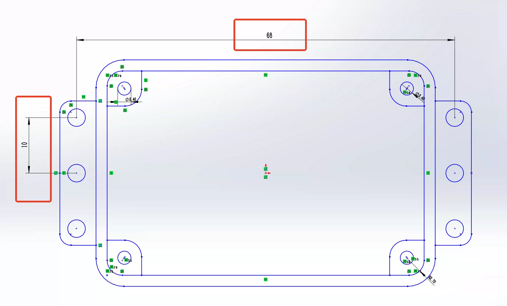

# YwRobot 鋰電池分電板設計圖

使用者於 2026-11-18 提供，名稱由使用者指定；原始 PNG 完整保存，未修改圖面。

## 紅框孔距

依使用者最後確認，紅框孔距為 **68、10**，與原圖一致：

| 位置 | 孔中心距 |
| --- | --- |
| 上方水平紅框：左右側耳對應孔 | 68 |
| 左側垂直紅框：相鄰孔 | 10 |

原圖未明示尺寸單位；此處保留標示數值，未由圖片比例推算其他尺寸。
本資料為設計參考，未作實物尺寸或裝配驗證。

## 原圖與完整性

- 檔案：[design-drawing.png](design-drawing.png)
- 來源：本次對話使用者附件 `codex-clipboard-9f7e94db-0069-4cac-a797-710d4cf7eda7.png`
- 大小：333451 bytes
- SHA-256：`3c38c50da7612df27b703dee9583a3cfea98ace5ca3b0159b0784d58ea13837b`

