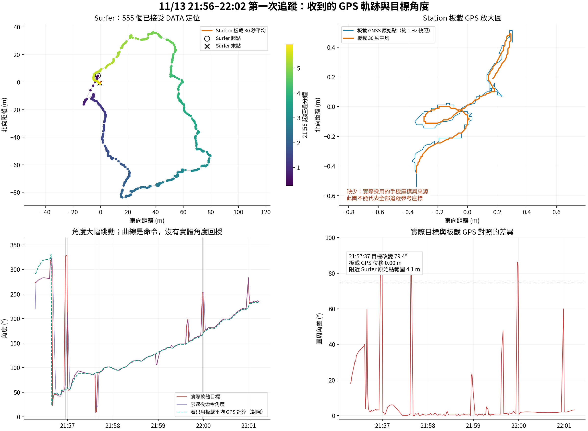
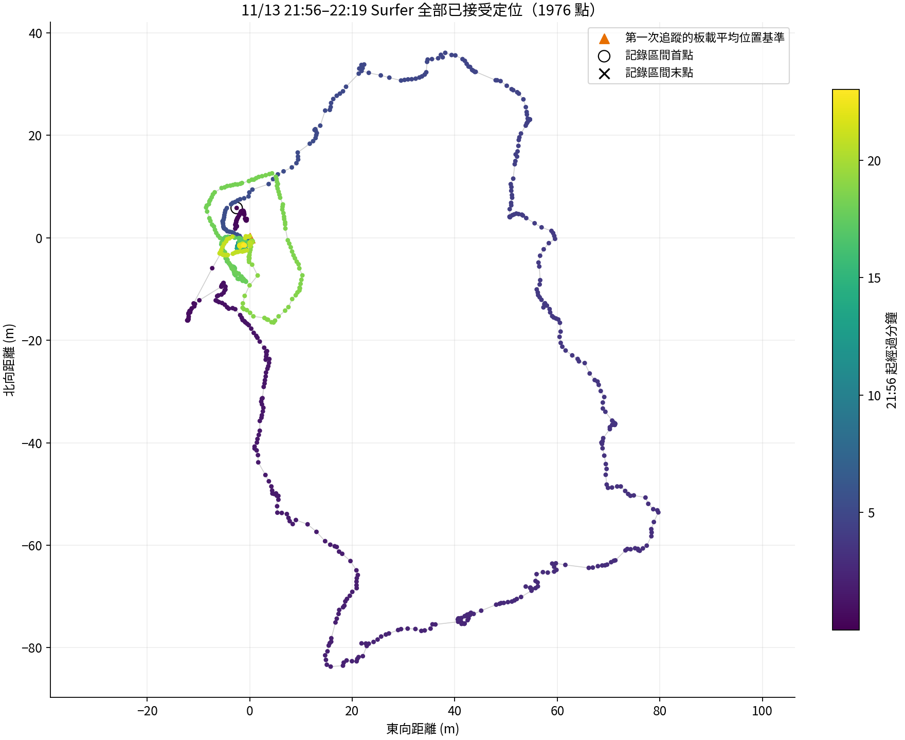
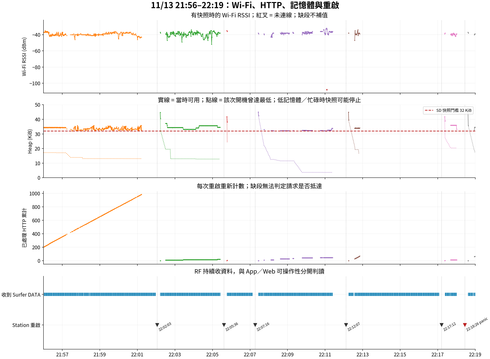

# 11/13 外測與 GPS-only 修正實驗紀錄

記錄日期：2026-11-14；時區：Asia/Taipei。外測區間為 **2026-11-13 21:56–22:19**。
本頁保存當時證據與判讀，不宣告戶外故障已全部修復。

## 使用者觀察與最新修正

- 第一次啟動 Servo GPS 追蹤大致正常，偶爾約 90° 大幅亂轉。
- 停止錄影後曾無法連上 Station；多次重啟 Station／手機網路後恢復。
- 後續 App／Web 手動調角仍看不到實體舵機動作，控制板實體旋鈕能帶動。
- 使用者最後補充：**「剛剛第一次除了 network gps 問題其他都正常」**。
  後續工作應先以第一次正常流程為基準，驗證單一 GPS 來源；不要將後段異常推論成所有機制都必須重寫。
- 下一個 session 希望程式更精簡、容易記住與 debug；可評估刪除階段性功能，但本輪尚未決定具體刪除哪些產品能力。

## 資料、時間與驗證方法

- 唯讀辨識 LilyGO Station 584C，暫停 SD 後匯出 9 個場次，逐檔核對 bytes／CRC32，再恢復錄製。
- 主要第一次追蹤檔：`0000000000000078-0000-attempt2.ndjson`，4,458,090 bytes，CRC32 `96490afc`。
  第一次 USB 傳輸不完整，保留為失敗證據，分析只使用第二次完整檔。
- 該次 Station boot `2204716233`，由同一開機內 UTC 與 `sample_ms` 重建時間。
  main build `Nov 13 2026 01:13:33`；SD translation unit build 時刻不同，不能據此認定兩份韌體。
- 主要場次有 580 個已接受 DATA；第一次追蹤圖含 555 個有效原始定位、223 個 GPS 控制快照。
  全區間共有 1,976 個已接受的有效 DATA 定位。射頻錯誤紀錄中的殘留 raw bytes 不當成有效位置。
- 239 個相同 seq 的 SD 快照與 wire E7 解碼座標逐筆一致。
- `sample_dropped` 是 SD 快照略過／丟棄，不是 RF 漏包；heap 低於 32 KiB 或忙碌時可能沒有快照，封包／文字仍持續記錄。
- 原始座標、USB 與 HTTP 證據保留本機私人資料夾：
  `~/.local/state/shore-spotter/field-investigation-20261113T235548+0800/`。
  Git 只保存本頁與相對座標圖，不納入私人原始軌跡、Wi-Fi 設定或憑證。

## GPS 與大角度跳動

- 21:56:16 左右切 GPS 模式。Surfer 在約百公尺尺度範圍移動，Station 板載原始定位在小範圍緩慢漂移。
- **21:56:57**：軟體目標由約 51.0° 變成 327.7°，圓周角變化約 −83.3°。
  相鄰快照 Station 板載原始位置約移動 0.049 m、Surfer 約 0.052 m；附近保留的 Surfer 原始點跨度僅 0.52 m。
  若以板載 30 秒平均位置計算，目標僅變約 0.11°，不足以解釋實際跳動。
- 21:57:37 與 21:59:58 也有約 79°／87° 目標變化，板載位置計算對照僅約 0.6°／1.9°。
- 校正偏移固定 269.5°，磁偏角幾乎不變。資料優先指向實際採用的岸端參考座標差異，而非相應的 Surfer／板載 GPS 大跳點。
- App 原始碼當時同時訂閱 GPS 與 NETWORK；只比較新舊，精度上限放到 100,000 m。
  因此較新的網路估算座標可以覆蓋較準的衛星定位。
- **證據缺口：** SD 記板載 GNSS／平均位置，未記實際採用的手機座標、provider 與精度。
  可確認這個程式行為存在，不能確認當晚每個尖峰都由 NETWORK 造成。
- 0／359° 是額外的行程問題：51° → 328° 在線性受限角度舵機上相差約 277°。
  本輪未改邊界／限速策略；圖中曲線是命令，沒有實體角度回授。

## Wi-Fi、記憶體、錄影與重啟

| 開機時間 | reset_reason | 有記到的最低 heap | 判讀限制 |
| --- | --- | --- | --- |
| 22:02:03 | 1，power-on | 13,076 bytes | 開機後 RF 持續，HTTP 請求較少 |
| 22:05:36 | 1，power-on | 24,420 bytes | 只有兩個快照，不能代表全場最低 |
| 22:07:16 | 1，power-on | **3,728 bytes** | 22:10:43–22:11:23 有 Wi-Fi 重連錯誤 |
| 22:12:07 | 1，power-on | 17,200 bytes | 快照後段停止，原始 DATA 持續 |
| 22:17:12 | 1，power-on | 20,844 bytes | crash 前未留完整 backtrace |
| **22:18:26** | **4，ESP_RST_PANIC** | 15,332 bytes | 可確認軟體異常重啟，不能定位肇因 |

- 第一次長場次在錄影前就曾熱點連線失敗，21:42–21:52 有 125 次 `sta is connecting, return error`，21:52:28 才記到位址。
- Wi-Fi 未連線時程式每 5 秒呼叫 `WiFi.reconnect()`；沒有足夠的斷線原因／連線階段證據來確認重試是否加劇問題。
- 有快照的已處理 HTTP 多數很快，最後場次最大約 236 ms；未抵達 handler 的請求、App 排隊與快照缺段不在此量測內。
- 第一影片檔名時間 21:56:55.801，媒體時長 292.668 秒，未暫停時最早結束約 22:01:48.469；與 22:02:03 重啟時間接近。
  第二段檔名 22:13:07.504、媒體時長 122.206 秒。影片有暫停時，牆上時鐘的結束時間會更晚。
- 目前 checkout 的停止錄影處理沒有直接重啟 Wi-Fi 或 Station；尚未用已安裝 APK 位元組比對這份 checkout。
  App 歷史 logcat 為空、無持久連線錯誤紀錄，不能把時間相近當成錄影造成故障的證明。

## 是否上傳 log 堵塞

- Axiom 完整查詢當晚 21:30–23:59 回傳 0 筆，只代表沒有查到入庫紀錄，不能證明沒有失敗嘗試。
- 回家後另一 boot 的即時 Axiom 狀態是 enabled／low_memory、requests=0、sent_bytes=0；不能套用成外測各次開機的計數。
- 原始碼與 API 證實：8 × 1,200 bytes 佇列＋12,288 bytes worker stack，至少 **21,888 bytes** 常駐 RAM。
  即使無法上傳，worker／佇列仍占用；停用後也不會直接回收。
- 上傳要求至少 100 KiB heap 與 48 KiB 最大區塊；外測有記下的可用 heap 最大約 56 KiB。
  因此有根據的候選是常駐資源壓力，尚未證實 TLS 上傳直接堵住主迴圈。

## 手動 Servo 與實體動作

- 22:18:56 起 Station 記到 119°、266°、109° 等手動目標，限速後命令角也改變，output ready、未記到 motion fault／命令 freshness 拒絕。
- 至少這些操作已抵達 Station。若當時實體仍不動，不能只歸因 Wi-Fi。
- SD 尚未保存每次 HTTP 命令來源／結果及 UART sent／deferred／errors；控制板沒有 ACK 或角度回授。
  串口是否真正輸出、控制板是否接收仍需分開驗證，本輪未主動驅動舵機。

## 已完成的單一修正：Android GPS-only

- 依使用者要求移除 NETWORK 訂閱；只訂閱 GPS provider，收樣與送出前拒絕非 GPS 來源。
- GPS 停用時清除 App 最新位置，重新啟用仍可由原 listener 恢復；無 provider 時顯示不支援，沒有其他來源 fallback。
- 保留前景 1 Hz 上限、10 秒 freshness、新樣本 gate 與 Station 相同快照確認。Wi-Fi／熱點仍照常供 HTTP 使用。
- JUnit 三組共 5 案例通過；assembleDebug 通過；lint 0 errors／26 warnings；4 個 64 位元 JNI 的 16 KB 對齊與 zipalign 通過。
- APK SHA-256：`7e2fbf19faf1edd3c91c2297cfd241917ba91b2c05d8ae91c753de56496bfb0c`。
  私人產物：`~/.local/state/shore-spotter/android-gps-only-20261114T002648+0800/shore-spotter-gps-only.apk`。
- **尚未安裝手機，尚未驗證 GPS-only 戶外效果；未改／燒錄 Station 或 Client。**

## 本輪結束狀態

checkpoint 前重新執行 `python3 tools/verify_project.py`，50／50 組主機回歸通過；沒有燒錄或開啟硬體操作。
FreeCAD 最小模型 ZIP／Document.xml 完整性通過，兩檔快照與來源 SHA-256 一致；這不是重新計算幾何結果。

SD 已恢復 recording，bytes／synced bytes 繼續增加，寫卡 errors=0；本次 USB 匯出失敗／重試使 USB 錯誤計數增加 2，與外測當時 errors=0 分開看待。
既有 Android／Station／T096 WIP 納入 checkpoint；指定 FreeCAD 資料夾的兩檔另保存為 `cad/shore-spotter-jetson-case/`，來源未改。
後續先讀 [下一 session 規劃](next-session-plan.md)。本頁與其他階段性紀錄在 checkpoint commit 後移出工作目錄，查閱方式見紀錄索引。
