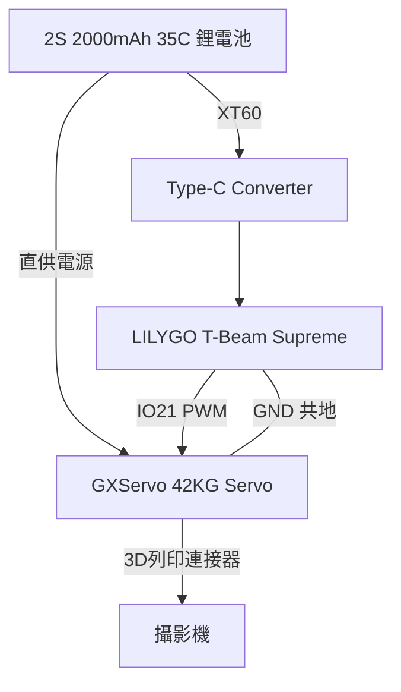

# 硬體說明（Hardware）

## 硬體參考圖

- [YwRobot 鋰電池分電板設計圖](assets/ywrobot-lithium-power-distribution-board/README.md)：2026-11-18 使用者提供原圖，紅框孔距最後確認為 **68、10**；附原圖與 SHA-256。

## 2026-10-28 現行控制與介面

目前使用中的組合為 **LilyGO T-Beam Supreme Station＋Heltec T096 Client**。
下方 AXP2101、18650、L76K 與 LilyGO 腳位表只適用 LilyGO；T096 是 nRF52840／UC6580，
Heltec V4 是另一種 Station 板型，不能交叉套用電源、GNSS 或接線說明。

現行原始碼已整合 Youmi 35 kg（5–8.4 V、359°）＋串口控制板，固定 **M0**。
LilyGO Station UART2 **9600 8N1、TX GPIO43、RX 不配置**；`#00P0500!`～`#00P2500!`，無換行。
`include/servo_controller.h` 合併最新目標、去重、最多 50 Hz 非阻塞送出；控制板自行產生 50 Hz PWM。
角度 0～359°，中位 **179.5°／1500 μs**；開機輸出中位、預設手動。沒有 ACK 或實際角度回授。
UART 寫入成功只證明 Station 交給 UART，不能證明控制板接受或 Servo 到位。
只留手動／GPS；舊 115200 SET／SET2／SYNC 外部輸入不再編入正常 Station，`mode=uart/jetson` 回 400。
GPS α UI、預測運算與設定 API 已移除；`/api/track/prediction` 回 404，舊 NVS 鍵不讀寫。
GPS 仍使用兩端有效且新鮮的位置、磁偏角與校正，失效轉完最後有效目標；不自動切換來源。
共用速限預設 30°/s、範圍 1～90；UI 輸入整數，API 可接受有限小數並以 0.001°/s 保存至 NVS `servospd`。GPS 目標每 50 ms 重算。

資訊頁為 **定位資訊／Station Info／Surfer Info 三區**，已移除控制板整卡。
定位主區保留衛星、Google Maps 座標連結、位置更新時間與 Station 來源；HDOP、手機回報半徑、
Station 30 秒 RMS 散布收進定位診斷。三者不能當作已量測的實際位置誤差。
手填欄位由上至下為經度／緯度／誤差，磁偏角與校正偏移留在定位區。
Station 區保留速度與指南針校正；移除版本、正常溫濕度、SD 狀態與速度保存成功文字。
既有環境提醒保留，SD 故障放底部提醒；原因與計數可由 `/api/sd/status` 查詢。
Surfer 主區保留可編輯的目標 ID、GPS、電池、上次回報、GPS 控制與可用時的頻道入口；
DATA／RF／命令／MCU 溫度收進診斷。MCU 溫度不是環境或電池溫度。
GPS 狀態使用新鮮 BLE／LoRa 狀態，未知或過期不假裝為關閉；Ready 不再定期送 LoRa STATE。

網頁已移除「鏡頭置中」按鈕。校正時先切手動，按**控制板實體置中鍵**，等鏡頭停穩，
再輸入北 0°、東 90°、南 180°、西 270°等指南針讀數；UI 接受整數 0～359、預設 90。
網頁送 `physical_center=1` 表示操作者確認，後端檢查手動、輸出正常、無故障及軟體動作已結束；
成功後以 **179.5°** 同步限速器、撤銷舊控制世代，下一輪輸出中位脈寬，校正值只存 RAM。
實體置中鍵沒有回授，後端無法量測鏡頭是否到位；舊 API 未帶此參數仍要求軟體精確中位。
手動完整圓軌道 0～359°，0／359 在下、90 左、180 上、270 右，放開才送、端點不環繞。
UI 刻度延續鏡頭方向反向映射 `ui=359-raw`；地理方位另依校正計算。
手機定位權限流程延後、不加複製診斷摘要。

1.0 執行期候選（沿用 0.7 BLE 流程） A=923.2 MHz、B=923.8 MHz，兩者均為 SF9／BW125／CR4/5／sync `0x12`；
舊 manifest 的 A/SF10 是建置 profile，不代表現行 Station／T096 的 SF。
頻道由使用者在 BLE 已認領且 Ready 時掃描 CAD／選擇；啟動後收到匹配 LoRa STATE 才保存 Station NVS，
不自動跳頻。各設定來源與界線見 [device-config.md](device-config.md)。

T096 本次開機第一個有效 BLE Claim 固定 owner；換 Station 必須先停舊 Station 搜尋，再重啟 Client。
USER 短按亮屏 60 秒／切換兩頁診斷，長按滿 5 秒後放開切換 ACT／SLP（未認領也可 ACT），RST 硬體重啟；UI=8 FB27 已部署，見 [維護操作](records-index.md#t096-maintenance-2026-10-28)。
目前 Ready 為保留 RAM 的 BLE 待機，GPS 關閉、LoRa 休眠；下方 2026-10-09 RTC／30 秒交換為歷史流程。

既有主機、部署與實機證據分別見 [資訊頁驗證](records-index.md#info-page-2026-10-27)、
[584C／FB27 BLE 與 LoRa 部署紀錄](records-index.md#ble-control-2026-10-27)及 [T096 維護部署紀錄](records-index.md#t096-maintenance-2026-10-28)。
本次文件同步沒有新增 build 或硬體驗收；實體置中校正、M0 接線／UART 接受、轉向、端點、帶載與戶外 GPS 精度不能由原始碼或主機測試推定通過。

## 以下為板型規格與歷史紀錄（控制與 UI 差異以上節為準）

本文件彙整 Shore Spotter 的硬體規格與接線：

> **2026-10-10 當時紀錄，後續決策以上節為準**：使用者指定 Youmi 35 kg、5–8.4 V、359°＋雙路串口控制板，
> LilyGO 透過 TX/RX 控制，控制板輸出 PWM。控制板供電 8.4 V、共地、手動燈亮，
> 旋鈕兩端接近一整圈為使用者確認；M0/M1 與 GPIO 未核定。9600 baud／指令／接線及首輪測試見
> [Youmi 控制板契約](records-index.md#servo-controller-youmi-2026-10-10)。本輪未改韌體／燒錄，
> 下方 GXServo、IO21 PWM、180°／333 Hz、回到90°為**舊軟體與歷史硬體**，不能當新組合接法。

1. **腳位圖（Pins Map）** — T-Beam Supreme GPIO 分配
2. **I2C 裝置位址** — OLED / 感測器 / PMU
3. **電氣參數與電源通道** — AXP2101 各路供電
4. **按鈕說明** — PWR / BOOT / RST
5. **Servo 規格** — 新 Youmi＋串口控制板；下方保留舊 GXServo 規格／驗證
6. **鏡頭指南針校正** — 磁針讀數、腳架固定與磁場干擾
7. **接線圖** — 電池直供 Servo / 攝影機（2026-09-09 使用者確認）

韌體行為見 [features.md](features.md)；封包/HTTP 介面見 [interface.md](interface.md)。

LilyGO T-Beam Supreme 的韌體啟動順序：先連接 AXP2101，再設定 ALDO3 為 3300 mV、啟用並讀回確認，
等待 10 ms 後才執行 LoRa SPI／radio.begin；無線電復原也重新套用與驗證。
PMU 連線、設定寫入或讀回失敗時不進行 radio 初始化，序列紀錄明示錯誤。
ALDO4 仍供 GPS；ALDO1 供 OLED／BME280，不因 OLED 睡眠而斷電。
這是寄存器設定驗證，不代表已量測實際電壓／RF 功率。
電源通道來源：[LILYGO 官方 T-Beam Supreme 文件](https://wiki.lilygo.cc/products/t-beam-series/t-beam-supreme/)。

T-Beam Supreme Station 使用8 MB QSPI PSRAM，`tbeam-station`明確設定`qio_qspi`及`BOARD_HAS_PSRAM`；
2026-10-04 的584C實機`GET /api/axiom`記錄中，`psram_total`為8,388,608 bytes，upload batch配置於PSRAM。
當時未改 Client 環境；記憶體配置與驗證見[歷史筆記](records-index.md#lilygo-t096-2026-10-04)。

---

# LILYGO T-Beam Supreme - V3.0 / L76K / 915mhz / SX1262

以下是 LilyGO 板型資料。腳位表的 Free 欄為原廠外露腳位資訊；現行 Station 已使用 GPIO43 作串口控制板 TX，不能再當空閒腳位接入另一個 UART。

### 📍 Pins Map

| Name                                         | GPIO NUM                   | Free |
| -------------------------------------------- | -------------------------- | ---- |
| Uart1 TX                                     | 43(External QWIIC Socket)  | ✅️    |
| Uart1 RX                                     | 44(External QWIIC Socket)  | ✅️    |
| SDA                                          | 17                         | ❌    |
| SCL                                          | 18                         | ❌    |
| OLED(**SH1106**) SDA                         | Share with I2C bus         | ❌    |
| OLED(**SH1106**) SCL                         | Share with I2C bus         | ❌    |
| RTC(**PCF8563**) SDA                         | Share with **PMU** I2C bus | ❌    |
| RTC(**PCF8563**) SCL                         | Share with **PMU** I2C bus | ❌    |
| MAG Sensor(**QMC6310U/QMC6310N/QC6309**) SDA | Share with I2C bus         | ❌    |
| MAG Sensor(**QMC6310U/QMC6310N/QC6309**) SCL | Share with I2C bus         | ❌    |
| RTC(**PCF8563**) Interrupt                   | 14                         | ❌    |
| IMU Sensor(**QMI8658**) Interrupt            | 33                         | ❌    |
| IMU Sensor(**QMI8658**) MISO                 | Share with SPI bus         | ❌    |
| IMU Sensor(**QMI8658**) MOSI                 | Share with SPI bus         | ❌    |
| IMU Sensor(**QMI8658**) SCK                  | Share with SPI bus         | ❌    |
| IMU Sensor(**QMI8658**) CS                   | 34                         | ❌    |
| SPI MOSI                                     | 35                         | ❌    |
| SPI MISO                                     | 37                         | ❌    |
| SPI SCK                                      | 36                         | ❌    |
| SD CS                                        | 47                         | ❌    |
| SD MOSI                                      | Share with SPI bus         | ❌    |
| SD MISO                                      | Share with SPI bus         | ❌    |
| SD SCK                                       | Share with SPI bus         | ❌    |
| GNSS(**L76K or Ublox M10**) TX               | 8                          | ❌    |
| GNSS(**L76K or Ublox M10**) RX               | 9                          | ❌    |
| GNSS(**L76K or Ublox M10**) PPS              | 6                          | ❌    |
| GNSS(**L76K**) Wake-up                       | 7                          | ❌    |
| LoRa(**SX1262 or LR1121**) SCK               | 12                         | ❌    |
| LoRa(**SX1262 or LR1121**) MISO              | 13                         | ❌    |
| LoRa(**SX1262 or LR1121**) MOSI              | 11                         | ❌    |
| LoRa(**SX1262 or LR1121**) RESET             | 5                          | ❌    |
| LoRa(**SX1262 or LR1121**) DIO1/DIO9         | 1                          | ❌    |
| LoRa(**SX1262 or LR1121**) BUSY              | 4                          | ❌    |
| LoRa(**SX1262 or LR1121**) CS                | 10                         | ❌    |
| Button1 (BOOT)                               | 0                          | ❌    |
| PMU (**AXP2101**) IRQ                        | 40                         | ❌    |
| PMU (**AXP2101**) SDA                        | 42                         | ❌    |
| PMU (**AXP2101**) SCL                        | 41                         | ❌    |

> \[!IMPORTANT]
> 
> 1. GNSS Wake-up is only available in L76K version
> 
> 2. Radio has its own SPI bus, and other peripheral SPI devices share the SPI bus.
>
> 3. T-BeamSupreme has three magnetometer versions: QMC6310N, QMC6310U, and QMC6309, each with a different device address.

### 🧑🏼‍🔧 I2C Devices Address

| Devices                                 | 7-Bit Address | Share Bus      |
| --------------------------------------- | ------------- | -------------- |
| OLED Display (**SH1106**)               | 0x3C/0x3D     | ✅️  (I2C Bus 0) |
| MAG Sensor(**QMC6310U OR QMC6310N**)    | 0x1C/0x3C     | ✅️  (I2C Bus 0) |
| MAG Sensor(**QMC6309**)                 | 0x7C          | ✅️  (I2C Bus 0) |
| Temperature/humidity Sensor(**BME280**) | 0x77          | ✅️  (I2C Bus 0) |
| RTC (**PCF8563**)                       | 0x51          | ❌ (I2C Bus 1)  |
| Power Manager (**AXP2101**)             | 0x34          | ❌ (I2C Bus 1)  |

> \[!IMPORTANT]
> If the I2C device is connected to pins 17 (SDA) or 18 (SCL)
> the sensor power supply must be connected to DC1. If connected to other LDOs
> the power must be turned on before accessing the sensor I2C bus
> otherwise, the I2C access will fail or freeze.
>
> The QMC6310U and QMC6310N use different device addresses: QMC6310U (0x1C) and QMC6310N (0x3C).
> The SH1106 uses either device address 0x3C or 0x3D. If using the QMC6310U version, the device address is 0x3C; if using the QMC6310N version, the device address is 0x3D.
> The screen device address using the QMC6309 magnetic sensor is 0x3C, the same as the QMC6310U.
>

> [!NOTE]
> **OLED 位址獨立偵測。** `detectOledAddress()` 先檢查 0x3D，存在就使用，否則選 0x3C；
> 不再靠磁力計初始化判定。這保留不同板子版本的螢幕支援，無需使用板上磁力計。

### BME280 Address

* If you need to change the BME280 device address, you can remove the resistor and then connect it to the fixed pad via a wire. This will change the device address to 0x76.

### ⚡ Electrical parameters

| Features             | Details                     |
| -------------------- | --------------------------- |
| 🔗USB-C Input Voltage | 3.9V-6V                     |
| ⚡Charge Current      | 0-1024mA (\(Programmable\)) |
| 🔋Battery Voltage     | 3.7V                        |

### ⚡ PowerManage Channel

| Channel    | Peripherals                              | Max Current                              |
| ---------- | ---------------------------------------- | ---------------------------------------- |
| DC1        | **ESP32-S3**                             | 2A(Includes ESP operating current 800mA) |
| DC2        | Unused                                   | X                                        |
| DC3        | External M.2 Socket                      | 2A                                       |
| DC4        | External M.2 Socket                      | 1.5A                                     |
| DC5        | External M.2 Socket                      | 1A                                       |
| LDO1(VRTC) | Unused                                   | X                                        |
| ALDO1      | **BME280 Sensor & Display & MAG Sensor** | 300mA                                    |
| ALDO2      | **Sensor**                               | 300mA                                    |
| ALDO3      | **Radio**                                | 300mA                                    |
| ALDO4      | **GPS**                                  | 300mA                                    |
| BLDO1      | **SD Card**                              | 300mA                                    |
| BLDO2      | External pin header                      | 300mA                                    |
| DLDO1      | Unused                                   | X                                        |
| CPUSLDO    | Unused                                   | X                                        |
| VBACKUP    | Unused                                   | X                                        |

* T-Beam Supreme GPS backup power comes from 18650 battery. If you remove the 18650 battery, you will not be able to get GPS hot start. If you need to use GPS hot start, please connect the 18650 battery.

### Button Description

| Channel | Peripherals                       |
| ------- | --------------------------------- |
| PWR     | PMU button, customizable function |
| BOOT    | Boot mode button, customizable    |
| RST     | Reset button                      |

* The PWR button is connected to the PMU
  1. In shutdown mode, press the PWR button to turn on the power supply
  2. In power-on mode, press the PWR button for 6 seconds (default time) to turn off the power supply

> 韌體用法（本專案）：Client 端**短按 PWR** 喚醒 OLED 顯示狀態 10 秒；**長按 PWR** 顯示關機畫面後由 PMU 斷電。Station 端長按 PWR 同樣為關機。Client 第一次完整讀取／清除啟動 IRQ 只建立基準；其後新的按下沿，在動畫／資訊頁內也能接受一般短／長按。初始殘留或持續按住開機鍵不算新按壓；硬體長按關斷仍由 PMU 自身設定決定，韌體未更改該設定。

# 舊 GXServo Brushless 42KG (QY3242BLS / GX3242)：歷史硬體與舊 PWM 韌體

> 以下僅適用當時 GXServo＋IO21 PWM 組合：**500–2500us, 180°**；文中的方向驗證與校正流程都是歷史紀錄。現行 Youmi＋串口輸出見本文件開頭。

> [!IMPORTANT]
> **旋轉方向：實機已確認為「角度增加 = 從上方看逆時針」**，與韌體追蹤公式的假設一致
> （`true_bearing = mount_offset + declination − servo_angle`，見 `main.cpp` 幾何註解）。
>
> 鏡頭校正只存 RAM；舊 NVS 安裝偏移不再沿用。
> 若日後把 servo 上下顛倒重裝，方向會反轉，追蹤會往錯的方向跑（surfer 往左、鏡頭往右），
> 而且**不會有任何錯誤訊息**。重裝機構後請務必重驗：
>
> 目前網頁滑桿採 `raw = 180 - ui`；手動從顯示 90 拉到 120，內部為 90→60，
> 從上方看相機應該**順時針**轉。若與此相反，
> 就要先修正安裝方向或控制幾何，再重新用鏡頭指南針校正；目前校正僅存 RAM，
> 已無 `SERVO_CAL_VERSION` 或校正 NVS 版本需要更新。

| Parameter | Value |
| --- | --- |
| 型號 | GXServo QY3242BLS / GX3242（42KG 級） |
| 馬達型式 | Brushless |
| 操作電壓 | 5.0V–8.4V |
| 控制訊號 | PWM, 1520us / 333Hz（常見標示） |
| PWM 輸入電平 | 3.3V–5.0V |
| 脈寬/角度 | 500–2500us 對應 180° |
| 堵轉扭力 | 30 kg.cm @ 6.0V / 38 kg.cm @ 7.4V / 42 kg.cm @ 8.4V |
| 空載速度 | 0.118s/60° @ 6.0V / 0.092s/60° @ 7.4V / 0.085s/60° @ 8.4V |
| Dead band | 2us |
| 防護 | IP65（依賣場標示） |
| 齒輪/軸承 | 金屬齒輪（常見為銅鋁組合）/ 雙滾珠 |
| 尺寸/重量 | 約 40 x 20 x 37mm / 約 69g |
| 線材 | Brown(-) / Red(+) / Orange(Signal) |

> [!IMPORTANT]
> 1. GXServo 42KG 在不同通路會有標示差異（例如殼材、齒輪材質、是否可程式化、角度選項）。
> 2. 本專案以 **180° 版本 + 500–2500us** 為準，若你買到 270/360° 版本，需重新校正行程。
> 3. 目前使用者確認 Servo 直接 **2S、2000 mAh、35C 電池**，不經 UBEC。一般 2S LiPo 充滿為
>    8.4 V，直供必須以實際 Servo 銘牌／規格支援該電壓為前提；本表通路規格不能代替實物核對。
> 4. Servo Brown(-)、電池負極與 T-Beam GND 必須共地；只接 IO21 訊號線無法形成有效的 PWM 電位基準。

資料來源（2026-07-23 查詢）：
- https://www.ariesrc.gr/en/servo-4/22326-gxservo-qy3242bls-42kg-brushless-motor-180-degree-metal-gear-digital-servo-for-rc.html
- https://hobbyant.com/p/sale-268576
- https://offthegridsun.com/Servo-Robot-Motor/GXservo-GX3242-42KG-Brushless-Steering-Gear-High-Speed-Servo

# 舊韌體鏡頭指南針校正（90° PWM 歷史流程）

本節保留舊版操作與公式，不適用現行 179.5° 實體置中確認流程。

目前只使用黏在鏡頭上的普通磁針指南針；韌體不初始化／取樣板上 QMC，不做 hard-iron，
也不保存板上校正到 NVS。上方表格仍記錄板子實際裝有的元件與位址。

先按「回到 90°」切為手動，等鏡頭停穩再輸入北 0°、東 90°、南 180°、西 270°等讀數。
校正僅接受 Servo 命令位置與目標均為 90°、不再移動；RAM 保存 `mount_offset = compass_bearing + servo_angle`。
GPS 追蹤以 `servo_angle = mount_offset + declination - true_bearing` 計算，維持原本
Servo 角度增加為逆時針的方向；台灣磁偏角依 GPS 位置／日期自動換算。

指南針需與鏡頭光軸朝向對齊。腳架轉動、重新架設、移動指南針或重開機後必須重校。
若磁針讀數隨 Servo 上電／轉動明顯變化，先拉開指南針與馬達／金屬的距離。
UART 只傳 Servo 絕對角度，不要求 GPS 或指南針校正。

# 歷史接線圖（新串口控制板接線見本文件開頭）

Servo 直供為 2026-09-09 使用者確認；2000 mAh × 35C 對應標稱 70 A，並非實測
持續輸出保證。線徑／長度、接頭、電池健康度與移動時電壓尚未量測。
使用者回報移動時抖動，固定時也偶爾抖一下；控制模式與抖動當下命令角度尚未核對。
抖動排查先量 Servo 電源接頭的動態電壓，再比較減輕負載與降低共用速限的結果；
保持角度時仍抖，也要檢查共地、訊號與 Servo 自身的定位修正。軟體限速無法
消除 Servo 內部的保持修正或機構共振。
電源需同時滿足 Servo 的電壓與電流要求，參考
[Pololu 供電說明](https://www.pololu.com/docs/0J40/7.a)；一般 2S LiPo 與 LiHV 充滿
電壓不同，參考 [Gens ace 電池說明](https://genstattu.com/blog/how-to-choose-the-best-2s-shorty-lipo-pack)。

## LilyGO 電源與電量量測（歷史 Station／Client 配置）

本節的 PMU、18650 與關機條件不適用 T096；目前 LilyGO 不再作為使用中的 Client。

- **Station**：2S 經 Type-C 變壓供 USB-C（PMU 視為 VBUS），同時板載 **18650** 作備援 → 像手機插著電使用。
- **Client**：板載 **18650** 單獨供電。
- 板上 **AXP2101 只量得到 18650（單 cell）**；2S 無法直接讀（對 Station 只是 VBUS）。
- 電量 %：**3.2V=0%、4.15V=100%**（線性）。低於 3.2V 自動關機；**接 USB（VBUS 在）時不關機**，Type-C 失效改吃 18650 過低才關（保險）。
- 接 USB/Type-C 時 OLED 與網頁顯示 **⚡**；「插著 Type-C 仍回報 18650 電壓」為正常。
- 18650 為 LilyGO 板載電池，亦是 GPS 熱啟動備援電源。

## 舊外部 UART 控制輸入（歷史 115200 baud 流程）

此輸入已移出正常 Station；GPIO43 現在是 9600 baud 控制板輸出，勿照本節接回舊輸入。
舊接法使用 3.3 V USB-to-TTL：TX 接 GPIO44、RX 接 GPIO43，共地，獨立供電時不接 VCC。
UART2 為 115200 8N1，與 GPS 的 UART1（GPIO9/8）分開。控制規則見
[uart-servo.md](uart-servo.md)。鏡頭上的磁針指南針跟著鏡頭轉；板上 QMC 不參與控制。

## LilyGO L76K GNSS／RX 設定（2026-09-19 歷史驗證範圍）

本版依 L76K 設定 115200 baud、500 ms 更新間隔，只開 RMC＋GGA；沒有使用 PMTK，
也未宣稱支援表中另一款 u-blox M10 的設定命令。先送 9600→115200 切換命令，再於
115200 重送，涵蓋冷啟動與 MCU 重啟但 GNSS 仍供電。未將設定另存 GNSS flash。
L76K 原廠要求 >1 Hz 時僅開一種 NMEA 語句；本版雙語句是使用者確認的驗證選擇，
必須在序列／診斷核對實際 epoch、RMC、GGA Hz，而非看到命令送出就認定已成功。
來源：[Quectel L76K 協定，第 22–23 頁](https://forums.quectel.com/uploads/short-url/kmb3zNuV2SldThkOOJoNg9th40S.pdf)。

Station 每次初始化／復原開啟 SX1262 boosted RX gain，較高接收耗電用於接收性能，
不是提高 Client 發射功率，也不能保證穿透水、人體、地形遮蔽。這次只驗證設定路徑與錯誤處理；
實際改善幅度須同位置、天線、姿態、頻率與 SF 的現場對照。ALDO3 讀回亦非供電電壓實測。

## Heltec V4 Station 與 T096 Client（板型資料與截至 2026-10-10 的歷史紀錄）

當時配置兩個獨立 RF group：A 是923.2 MHz／SF10（group 0），B 是923.8 MHz／SF9（group 1）。
兩組均用 BW125 kHz、CR4/5、sync word `0x12`，當時不掃描／協商，SF9與SF10不互通。
現行 Station／T096 已改為 A/B 均 SF9 的執行期候選與手動 CAD，不能沿用本段的舊控制流程。
10/2完成Heltec V4／T096桌上部署；10/6 LilyGO E91C已改Station／SD，10/7 E91C／F035同步更新B組SF9。
10/10 T096 RTC修正版已部署，帶殼內建GNSS外測定位／速度品質未通過。
其他Station的版本須分別核對，不能由同組配置推定已更新；狀態見 [交接入口](assistant-handoff.md)。

Heltec V4 Station 使用 ESP32-S3 N16R2（16 MB flash、內嵌 2 MB QSPI PSRAM，不是 R8/OPI）。

| 功能 | GPIO／設定 |
|---|---|
| SX1262 | SCK 9、MISO 11、MOSI 10、NSS 8、DIO1 14、NRST 12、BUSY 13、TCXO 1.8 V |
| OLED | SSD1306：SDA 17、SCL 18、RESET 21；Vext GPIO36 active-low |
| 舊 Servo PWM | GPIO4（Heltec 公開 header 的外接 GPIO）；歷史 PWM 命令，無實體角度回授 |
| 外接 GNSS | RX 39／TX 38 僅屬擴充模組；裸板未安裝時不初始化 GNSS |
| 無板載項目 | 無 AXP2101、SD、BME280；電量／充電必須呈現 unknown，不能把 0 當健康 |

FEM power 為 GPIO7、CSD 為 GPIO2。auto profile 依 Meshtastic 的 runtime probe：上電後釋放 GPIO2
為 input，連續 8 次全低是 GC1109、全高是 KCT8103L，任何不一致 fail closed，不猜 RF path。GC1109
使用 CPS GPIO46、DIO2 自動 CTX；KCT8103L 使用 CTX GPIO5（TX high／RX LNA low）、DIO2 自動 CPS。
`heltec-v4-2-station`／`heltec-v4-3-station` 是明確 override，僅適用已確認 FEM 的板。
本次 USB 確認 R2／16 MB flash，runtime probe 為 KCT8103L，屬 V4.3 FEM 路徑；這不能確認板面細分版號。
雙向 RF 已通；OLED 僅有初始化成功訊息，實際顯示與 GPIO4 Servo 尚未驗收。
0 dBm 是 SX1262 chip drive；FEM enabled 不是天線輸出功率量測。
以上為當時的板上結果；現行 V4 原始碼指定串口 TX GPIO43，實體 header／接線仍須核對，不能把舊 GPIO4 PWM 驗證視為串口驗收。

T096 是獨立 nRF52840 Client，沒有 ESP Web/Wi-Fi，也不以 fake GNSS 冒充定位：SX1262 NSS 5、DIO1 21、
RESET 16、BUSY 19，SPI SCK 40/MISO 14/MOSI 11，FEM power 30/CSD 12/CTX 41，chip drive 0 dBm；
GNSS enable 6（low active）、reset 46、PPS 43、RX 23、TX 25，115200 baud；battery ADC 3/control 47、
button 42、LED 28、Vext 26。RF 收發與 USB VBUS 回報已在桌上確認。
2026-10-09當時改為保留RAM的SystemON／RTC定時待機，取消Ready 12小時SystemOFF及日常深度休眠操作；現行 BLE Ready 以上節為準。
WOUT接太陽能接口、PCB BAT留空、電池接T096；WOUT充電與離座接手已於前輪觀察，
但該solar路徑沒有送MCU VBUS，因此原SystemOFF放座自動喚醒未通過。RTC版本不再依賴這條喚醒路徑。
電池1,000mAh，使用者提供4.2V過充／2.7V過放保護板；韌體3.2V先停止GPS／新RF，每60秒檢查，
穩定3.5V回Ready。硬體保護切斷後的充電恢復、整機電流與續航尚待量測。
USB VBUS只是USB供電訊號，不可用`charging:false`判solar沒有充電。

歷史SystemOFF／USER修正與實機結果見[t096-power-validation-2026-10-08.md](records-index.md#t096-power-validation-2026-10-08)，
歷史RTC待機驗證見[t096-rtc-standby-2026-10-09.md](records-index.md#t096-rtc-standby-2026-10-09)，現行流程見[BLE 控制](records-index.md#ble-control-2026-10-27)。

### T096 外接 GNSS 天線（2026-10-10 規劃）

[Heltec官方T096頁面](https://heltec.org/project/t096/)說明預設GNSS RF路徑接LDS內建天線。
使用GNSS ANT IPEX前，須依[官方選路圖](https://heltec.org/wp-content/uploads/2026/06/t096-gns-1024x494.png)
將選路電阻從紅框①移焊至綠框②；不是只插外接天線便自動切換。實作前核對實際板版／焊位。
GNSS和LoRa的IPEX 1.0接口不同，不可互換；UC6580使用L1＋L5，天線頻段、主動／被動與偏壓供電
要依實際天線型號和電路核對，尚未選定。外接天線是否仍放殼內，取決於天線／殼材與擺位，不能保證效果。
原廠建議TFT側朝天空、避免金屬遮蔽；需和電池／無線充電線圈的殼內位置一併驗證。
本輪尚未移焊或換天線；[10/10外測](records-index.md#t096-field-validation-2026-10-10)支持測試這個方向，但不能單獨判內建天線故障。

### T096 GNSS 上游供電（2026-10-02 桌上確認）

T096 V0.2 電路圖中 Vext 供應 GNSS 的 Q3 load switch。HT-n5262G variant 腳位
26 HIGH 與 GNSS_EN 6 LOW 必須同時成立；只拉 GNSS_EN 而關 Vext 會完全收不到 UART。
Vext也供應TFT，不可用關閉共用Vext作為追蹤時的省螢幕電方案。10/5加入畫面後，Ready保留Vext，
以ST7735 SLPIN與backlight GPIO44 HIGH省電，GNSS enable GPIO6 HIGH切掉GNSS；RTC待機保留TFT供電。
TFT是ST7735 MINI160x80_PLUGIN，CS22/DC15/RST13/SCK20/MOSI17、backlight44 active-low。
stock nRF SPI要求有效MISO pin，TFT write-only使用未用的外露P0.31輸入；獨立SPIM2、不共用LoRa SPIM3。
電池ADC為P0.03、control P1.15 HIGH enable；原廠3.0V reference／12bit／BAT_AMPLIFY4.9。
本次恢復 UART 後讀到 UC6580I-00／R6.0.0.0Build3700；2 Hz NMEA 已量到，室內尚無衛星 fix。
參考：[原廠電路圖](https://resource.heltec.cn/download/Mesh_Node_T096/Schematic/Mesh_Node_T096_V0.2.pdf)、
[UFirebird II 協定](https://en.unicore.com/uploads/file/UFirebirdII%20Series%20Protocol%20Specification_EN_R1.6.pdf)。
第三個 CFGNAV 欄位在這顆出廠韌體須保留1000；100/0都被拒絕。此為指定韌體實測，不能推廣到所有 UC6580。
