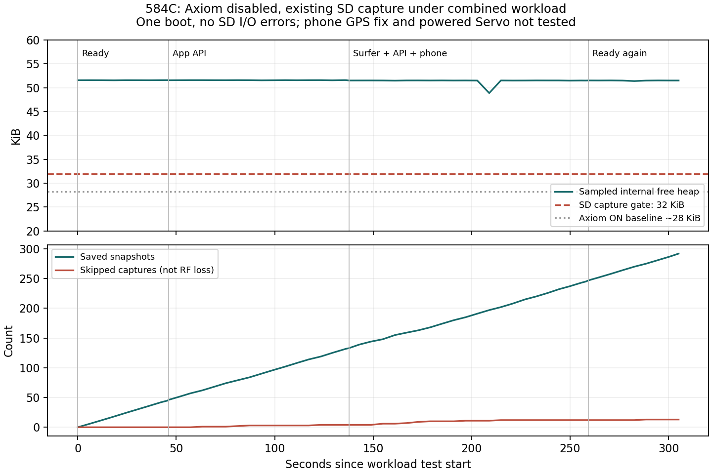

# Station 記憶體對照與實際使用留證（2026-11-14）

## 範圍與結論

使用者要求避免讓 debug 成為 bug 來源，自主測試 Axiom／網頁／OTA／App／Surfer 的實際負擔，
並讓戶外跳角、失聯或重開有資料可查。使用者已確認 Servo 斷電並授權重啟；本輪沒有機械動作驗收。

584C 原 boot `3950833316` 已運行約14.6小時：SD 文字持續寫入、errors=0，位置快照卻停在20筆。
20秒對照中 heap 約28.8 KB、Axiom requests=0、queue_depth=0，sample_dropped 52637→52657。
既有 NVS 的 Axiom enabled=true，仍配置8×1240-byte queue＋12288-byte stack，至少22208 bytes內部 RAM；
32 KiB batch 已在 PSRAM。停用後 queue／stack 仍保留，重啟才不建立。

本輪保留 Token／配對／Wi-Fi／RF／SD，僅將 Axiom 設為 disabled 並重啟。
相同韌體的新 boot `260203962`，heap 約52～55 KB，SD快照恢復增加。
這證明 Axiom 是本次可移除的固定負擔，不證明它是歷史 panic 或所有記憶體波動的唯一原因。

## 程式路徑核對

- SD 掛載失敗會停止 accepting／wanted 並排空固定 queue，沒有自動將整場資料轉存 RAM／Flash。
- 網頁 HTML 約94595 bytes 位於 Flash rodata，經 send_P 傳送，JS／地圖／瀏覽器歷史在手機執行。
  板端仍有路由物件、4096-byte文字 ring、4112-byte RF事件 ring及暫時 HTTP／lwIP配置；沒有將它們判為零成本。
- OTA 是區網 UDP 更新服務，並非背景雲端韌體備份；UDP TX buffer1460 bytes、既有 mDNS stack4096 bytes等仍占RAM。
  Update 的4 KiB寫入 buffer在開始更新時才配置；app0／app1與NVS是Flash分區。
- BLE 是必要控制通道，worker stack8192 bytes、SDK host stack5120 bytes及協議資源。
  掃描結果會保留到下次掃描清除；本輪沒有在未知跨執行緒條件下改動其釋放方式。

## 同一舊韌體、Axiom 停用後的組合測試

| 情境 | 時長約 | SD快照增量 | 採樣略過增量 | SD I/O錯誤增量 |
| --- | ---: | ---: | ---: | ---: |
| Ready、低負載 | 45秒 | 45 | 0 | 0 |
| Ready、App同樣API輪詢 | 90秒 | 86 | 4 | 0 |
| Surfer Tracking＋API；後段加入真機App錄影／面板 | 120秒 | 112 | 8 | 0 |
| Stop回Ready、API持續 | 45秒 | 45 | 1 | 0 |

57個觀察點、測試請求錯誤0；Surfer Start由匹配LoRa STATE確認，Stop由控制狀態確認回Ready。
抽樣 heap 最低約50 KB；另有瞬間歷史最低25068 bytes，不能用抽樣曲線宣稱從未低於32 KiB。
略過可能包含busy／loop期限等，不等於RF漏包，亦不是全程零遺失。

完整SD匯出2915410 bytes、CRC32 `74d6f927`，1435行全部JSON可解析：
713個位置快照、48個原始LoRa紀錄、526個文字紀錄；每個快照都有station_position。
但713筆UTC全部null，實查校時原本只由Axiom啟動，不能將停用後的紀錄直接與手機時間對齊。

## 最小留證修正

程式commit `a9fbb1e`：沿用既有快照，追加control epoch／command_seq及Youmi UART送出／暫緩／錯誤／pulse。
Sample1240→1264 bytes，SD兩筆queue payload僅增加48 bytes；無新增queue、worker或重試。
producer／encoder回歸先紅後綠；兩個schema238個欄位路徑，低於256。

該中間版build `Nov 14 2026 16:42:03`、boot `2048460766`，application-only hash通過。
Servo斷電下測179.5→185→179.5，UART commands1→7→12、errors=0；重複命令409拒絕。
SD實際匯出310筆快照，含序號0／1／2及送出計數1／7／12，但UTC仍null。
這些是UART／記錄證據，沒有控制板ACK或實際角度回授。

程式commit `c0dbd44`：將既有SNTP交由Station首次Wi-Fi連線時啟動一次，Axiom不再啟停共用時鐘。
不等待校時才記錄；尚未校時／無網路時UTC維持null與boot／sample_ms，不虛構時間。
actual helper覆蓋離線、首次連線、重複呼叫／重連；完整主機51／51與Station build通過。
最終部署／UTC讀回結果如下，現役版本亦同步交接入口。

## 最終部署與讀回

Station build `Nov 14 2026 16:52:02`、boot `4000732695`、source `c0dbd44`，
active app1 application-only hash通過，NVS／分區／SD／舊coredump保留。
bin SHA-256 `427c1cde0c6951e1205ea3fe767eb5e726411554d9c8a79435d076cd15792d4e`；
ELF SHA-256 `7e38a10df1d396fcd8b56a578e659d0410967db8f8aa6060352d6772012ec06c`。
完整主機51／51與Station build通過；最終產物及私有設定fingerprint保存於`field-ready-firmware/manifest.json`。

同樣測179.5→185→179.5、拒絕重複命令409，Surfer Start confirmed Tracking→Stop confirmed Ready。
最後約45秒API負載觀察快照+37、略過+5、抽樣heap最低49576 bytes，SD I/O errors=0；
不可把本輪略過全部歸因記憶體，也不能宣稱全程1 Hz零遺失。

最終SD完整匯出504598 bytes、CRC32 `7496e4c6`，266行全部JSON可解析：
117個快照全部有UTC、station_position及controller，控制序號0／1／2，UART送出最高12、錯誤0。
UTC範圍`2026-11-14T08:53:22.083Z`～`08:55:49.361Z`，不需Axiom上傳或衛星fix。

首輪USB讀取先遇到殘留`@SD ERROR ... overflow=1`，沒有進入檔案本文；原始錯誤與0-byte partial均保留。
保留185 bytes舊USB輸出並清掉殘留輸入行後，重新取得stopped／同步完成／errors=0狀態，
再以原讀取器完整驗證長度／CRC成功，沒有裁切檔案或跳過CRC。
USB write errors當時為1，成功讀回及恢復錄製後未增加；不是SD I/O錯誤，也未定位殘留輸入的根因。
這是主機USB匯出限制，仍應檢查增量，不以成功匯出抹去首次失敗。

## 既有 Flash coredump

SDK與ELF原本已有Flash／ELF／CRC32 coredump，不需新增裝置記錄機制。
本輪先同步／匯出SD，再完整讀出已核對的64 KiB分區；非空白，有效長度39556 bytes，CRC32 `05108b05`通過。
dump的ELF prefix `357aaac6e`符合舊rollback application，與本輪保留的baseline ELF不符；
私有state目錄13份ELF皆無匹配，因此沒有用錯ELF硬解backtrace，不能判為11/13特定那次或定案根因。
目前每個部署版都保存bin／ELF／SHA-256，之後可依同樣流程取回並配對。
沒有故意製造panic；64 KiB容量、斷電或未進panic handler的錯誤仍有限制，詳見[取回流程](debug-export.md)。

## App與驗收界線

Pixel10／Android17、既有App0.3：解鎖後只操作Shore Spotter，錄影時展收Station面板、暫停／繼續，
背景完成保存後回前景再錄。兩段影片103.102／33.745秒、1920×1080、約30FPS，均無音軌；測完已結束App。
沒有取得衛星fix、沒有network／fused補位，沒有開GPS追蹤或改手機全域設定。
Surfer Start／Stop與API／SD的室內組合驗證，不是戶外GNSS／RF範圍或接電Servo／電源干擾驗收。

私有完整證據：`~/.local/state/shore-spotter/memory-audit-20261114T161306+0800/`。
原始位置／影片／NVS metadata／coredump／ELF不提交公開repo；此圖只有匿名化計數。
外測若異常，使用者只需記時間／操作並保留裝置與SD；回來由agent匯出，不先格式化或重刷。

收尾已恢復SD recording，確認後8秒快照增加8筆，SD errors=0、USB write errors維持1；
Surfer Ready／BLE claimed，Station手動179.5°、60°/s，Axiom disabled。SD重掛載曾超過首輪12秒檢查，
後續已以實際recording及遞增計數確認，不能把START受理當成立即錄製完成。
