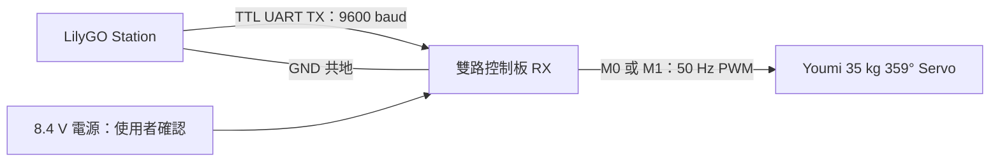

# Youmi 35 kg＋雙路串口 Servo 控制板（2026-10-10）

## 2026-10-11 現行控制與介面

正式原始碼已整合 Youmi 35 kg（5–8.4 V、359°）＋串口控制板，固定 **M0**。
Station UART2 **9600 8N1、TX GPIO43、RX 不配置**；`#00P0500!`～`#00P2500!`，無換行。
`include/servo_controller.h` 合併最新目標、去重、最多 50 Hz 非阻塞送出；控制板自行產生 50 Hz PWM。
角度 0～359°，中位 **179.5°／1500 μs**；開機輸出中位、預設手動。沒有 ACK 或實際角度回授。
UART 寫入成功只證明 Station 交給 UART，不能證明控制板接受或 Servo 到位。
只留手動／GPS；舊 115200 SET／SET2／SYNC 外部輸入不再編入正常 Station，`mode=uart/jetson` 回 400。
GPS α UI、預測運算與設定 API 已移除；`/api/track/prediction` 回 404，舊 NVS 鍵不讀寫。
GPS 仍使用兩端有效且新鮮的位置、磁偏角與校正，失效轉完最後有效目標；不自動切換來源。
共用速限預設 30°/s、整數 1～90，NVS `servospd` 保存；GPS 目標每 50 ms 重算。

資訊頁四區：**定位資訊／Station Info／控制板／Surfer Info**。
座標只顯示 Google Maps 連結；手填欄位由上至下經度／緯度／誤差。
卫星顯示無／少／中／多；HDOP 下方說明其為幾何指標，不能換算成已知實際誤差。
手機回報半徑、Station 30 秒 RMS 散布、實際誤差分開；真實誤差需對照已知參考位置。
Station 顯示自有溫濕度與 SD 記錄狀態，無運行時間／Servo 來源／SD 錯誤計數；
Surfer 顯示電池、GPS 開啟／關閉、STATE／DATA 年齡與 RF 品質，無 USB 供電列。
GPS 狀態只依近期 STATE；未知或過期不假裝為關閉。
控制板區顯示 M0、串口、命令角度／脈寬／字串與 UART 計數，實際角度為未知。
磁偏角移到定位資訊；速度點數字開視窗、儲存成功才關閉，指南針整數 0～359、預設 90。
「鏡頭置中」回 179.5°；停穩後填北 0°、東 90°、南 180°、西 270°重新校正（只存 RAM）。
手動完整圓軌道 0～359°，0／359 在下、90 左、180 上、270 右，放開才送、端點不環繞。
UI 刻度延續鏡頭方向反向映射 `ui=359-raw`；控制板區顯示 raw 角度；地理方位另依校正計算。
手機定位權限流程延後、不加複製診斷摘要。

部署目標：LilyGO 584C，B 組 923.8 MHz／SF9、wire v5；已 application OTA 更新，HTML 比對、M0 輸出與持續 STATE 通過；見 [部署驗證](servo-ui-deployment-2026-10-11.md)。
主機通過 140 項 native、實際 HTTP／UART／GPS gate／NVS、圓形操作及地圖回歸。
實體 M0 接線、UART 接受、轉向、端點、帶載及戶外 GPS 精度仍待驗收。

## 初次 demo 階段的證據與提案（歷史）

## 已確認方向與目前部署差異

使用者明確指定：今後專案綁定 **Youmi 35 kg、5–8.4 V、359° Servo＋下述雙路控制板**。
Station 透過 TTL UART 傳指令給控制板，由控制板產生 PWM；不再以 Station PWM GPIO 直驅為產品方向。
品牌以本次更正的 **Youmi** 記錄；先前寫作 Youmu。確切 Servo 料號未知，不用其他品牌規格替代。

**本輪只製作 UI demo、整理硬體／整合契約，沒有修改正式 Servo 韌體、編譯或燒錄。**
`include/servo_profile.h`／`src/main.cpp` 仍為舊 GXServo 180°、333 Hz LEDC，
`src/uart_servo_mode.cpp` 仍是 115200 baud 外部目標輸入。現行 UI 的 `pwm_ok`、角度和命令成功
都不能證明這塊串口控制板已被驅動。`demo/info-page/` 完全使用模擬資料，無裝置請求。

## 證據來源

- 使用者提供四張商品／操作說明圖片：控制板外觀、11 條規格、模式／串口命令、USB-TTL 接線。
  原始附圖已保存：[外觀](assets/youmi-controller/board.png)、[規格](assets/youmi-controller/specifications.png)、
  [模式與命令](assets/youmi-controller/protocol.png)、[串口接線](assets/youmi-controller/wiring.png)，供其他助手核對。
- 商品連結：[淘寶控制板](https://c.tb.cn/h.jbfG6o0jxU1kEwv?tk=GxG5TrW0o2T)。本輪工具無法開啟短連結，協定依附圖，不宣稱已讀取賣場。
- 使用者確認控制板 **8.4 V** 供電、與 LilyGO TX／RX 交叉相接且共地，手動燈亮。
- 使用者透過旋鈕目視確認 Servo 兩端接近一整圈（0～359°）；這是使用者目視，非角度儀量測。
- GPIO 數字、Servo 在 M0 還是 M1 未確認；不能只由排針 TX/RX 字樣推定實際 GPIO。

## 控制板文件提供的規格

| 項目 | 文件值／含義 |
|---|---|
| 控制通道 | M0、M1；旋鈕／回中會同時控制，串口可分別控制 |
| 模式 | 按 S1 切手動／回中，模式燈提示；手動模式才接受串口位置命令 |
| 手動來源 | 預設旋鈕；旋鈕轉動切回旋鈕，收到有效串口命令切到串口 |
| UART | 9600 baud，宣稱兼容 3.3 V／5 V 輸入；8N1 是首輪試驗預設，圖片沒有明載 frame 設定 |
| 命令 | ASCII `#<ch>P<time>!`，ch 為兩位 `00`／`01`，time 為四位微秒脈寬 `0500`～`2500` |
| 結束符 | `!`；文件不要求 LF／CRLF，首輪精確送原始字串 |
| 範例 | `#00P1500!`：M0 1500 μs；`#01P1000!`：M1 1000 μs |
| 控制板 PWM | 週期 20 ms＝50 Hz；脈寬 500～2500 μs |
| 脈寬解析度 | 宣稱 1 μs；文件的「0.09°」是以 180°／2000 μs 計算，不是 Youmi 的實測角度精度 |
| 控制板供電 | 5～9 V，但本組 Youmi 額定上限為 8.4 V，以 Servo 上限為準 |
| 尺寸／重量 | 47.2×29.8 mm／11 g（賣家圖片） |
| ACK／位置回授 | 圖片沒有定義，尚未確認；成功寫入 UART 只代表主機已送資料 |

文件所寫「500–2500 μs＝0–180°」是在描述常見 Servo。搭配使用者的 359° Servo，
控制量仍是脈寬；不能直接把文件角度當作這顆 Servo 的實際角度。
暫定待驗線性模型：`pulse_us = round(500 + angle_deg × 2000 / 359)`，
1500 μs 對應約 179.5°；1 μs 對應約 0.1795°指令解析度，**不代表實際定位精度**。
兩端脈寬、機械中位、轉向、重複性、負載與保持抖動都要另外量測／目視驗收。

## 接線與兩種 UART 角色

1. **新輸出**：Station → 控制板，9600 baud，`#00P1500!` 等脈寬命令。
2. **既有外部輸入**：Jetson／其他控制端 → Station，115200 baud，`SET`／`SET2`／`SYNC`，只在 UI「UART」模式接收。
   GNSS 另佔 UART1 RX9/TX8；既有外部輸入用 UART2 RX44/TX43。

若新控制板也接 GPIO43/44，就不能將同一 UART 同時當 115200 輸入與 9600 輸出。
使用者本輪已確認 **不需要外部 UART 輸入，產品只留手動／GPS**。
demo已移除UART模式；正式韌體後續移除外部輸入，再配置9600輸出。實際GPIO仍待核對。

圖中「兼容 3.3 V／5 V」沒有保證控制板 TX 輸出電壓。
第一輪建議僅 Station TX → 控制板 RX＋GND；控制板 TX 回接 Station RX 不是送位置命令的必要條件。
須核對 TX 電平／回覆用途後再接回，不能假定 LilyGO GPIO 支援 5 V。
8.4 V 供電只進控制板電源端，不進 Station 的 UART／3.3 V 腳。

## 有界實機 debug 順序（尚未執行）

1. 識別實際 Station、GPIO、控制板通道和供電，確認手動燈亮；串口測試時保持旋鈕不動。
2. 先將 Servo 目視放在接近行程中段。使用 USB-TTL 可直接測控制板而不燒 Station；
   使用目前 LilyGO 接線則需要先加入新 UART 輸出並部署診斷韌體，舊 API 無原始字串透傳。
3. 9600 baud／8N1，只送單一通道 `#00P1500!`；目視記錄動作。若該通道無反應，再對 M1 試 `#01P1500!`。
   M0/M1 對旋鈕看似沒差，但串口分開尋址，因此要查明，不把沒動直接判串口故障。
4. 找到通道後，在中位附近試 1445／1500／1555 μs，記錄方向、約 ±10°行程與是否保持穩定。
   小步指令不表示已驗證軟體限速；第一次絕對位置命令沒有已知實際起點。
5. 中段／方向通過後，逐步擴大脈寬並記錄兩端，才確認 500／2500 與 0／359 的校正。
   不能把「接近一整圈」當作可無限旋轉；359→0 必須定義有限行程與線材限制。
6. Station 主機限速器持續產生脈寬點；9600 baud 單條 9 bytes、8N1 約 9.375 ms。
   先以不超過 50 Hz 的輸出節奏試驗，合併未送出的最新目標、抑制重複脈寬，避免排隊舊軌跡；吞吐與控制板接受率待測。
7. 後續才整合手動、GPS、外部輸入、校正、開機動作、失效保持與 359°端點策略。
   未量得控制板 ACK／角度回授時，UI 分開顯示「指令寫入」、「目視動作」與「未知實際角度」。

## UI demo 與未決產品選項

- 使用者已確認 **完整圓形0～359°軌道**；本輪加到demo，正式雷達仍未改。
  demo的0／359兩端在下方、中位約179.5在上，90在左、270在右；用指令角度展示，
  轉向／地理波束映射仍需實機校準。拖曳跨端點夾住，不把有限行程假定成無限旋轉。
- 「指南針輸入預設 90°」是朝東，與 Servo 行程中位約 179.5°不同。
- 「鏡頭置中」本 demo 示意 179.5°，正式動作以實測中位為準；不把舊 90°中點沿用。
- GPS α 在 demo 不顯示；正式功能、設定／API 移除尚未實作。
- 手機定位權限流程延後；不加複製診斷摘要。來源 toggle 只在 demo 變更模擬顯示。
- 所有 UI 數字均為 mock，無真實路線、帳密或裝置命令。
